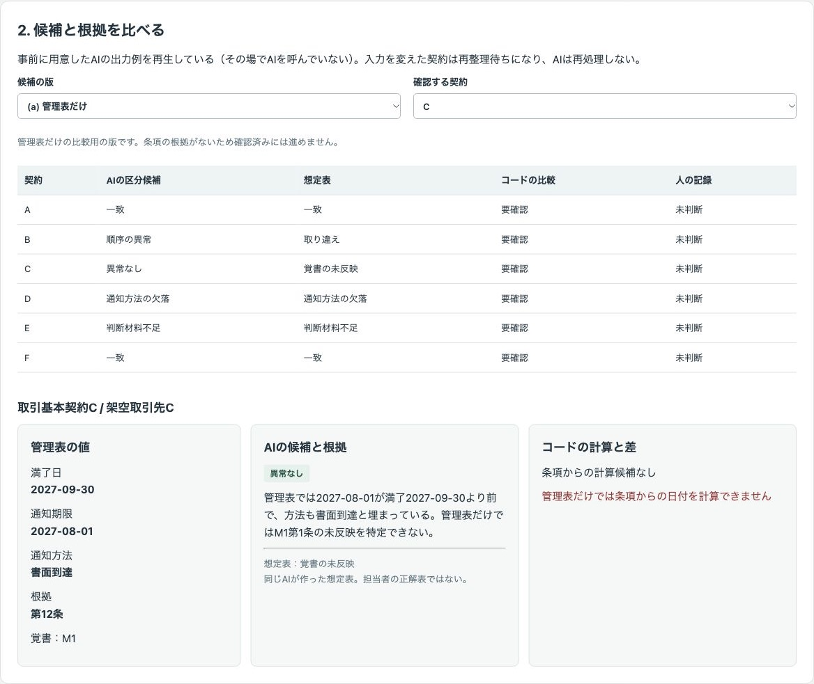
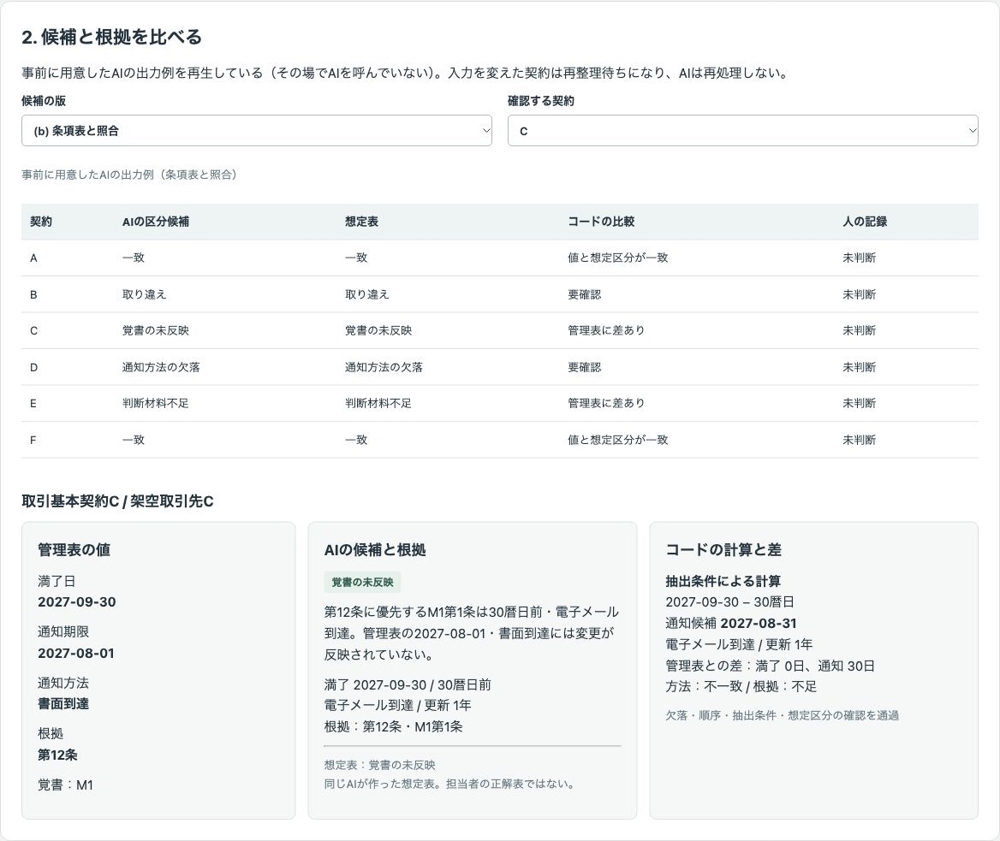
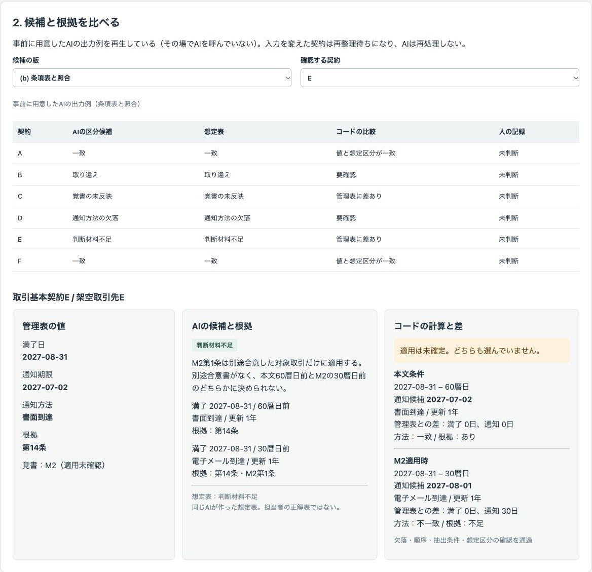
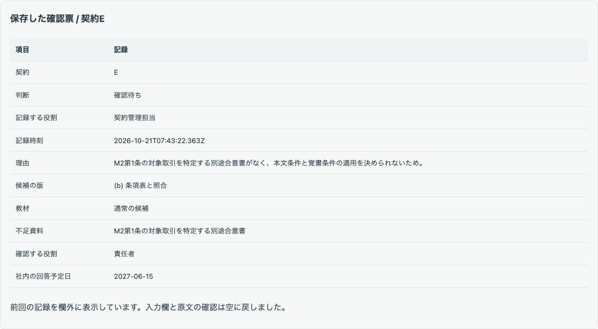
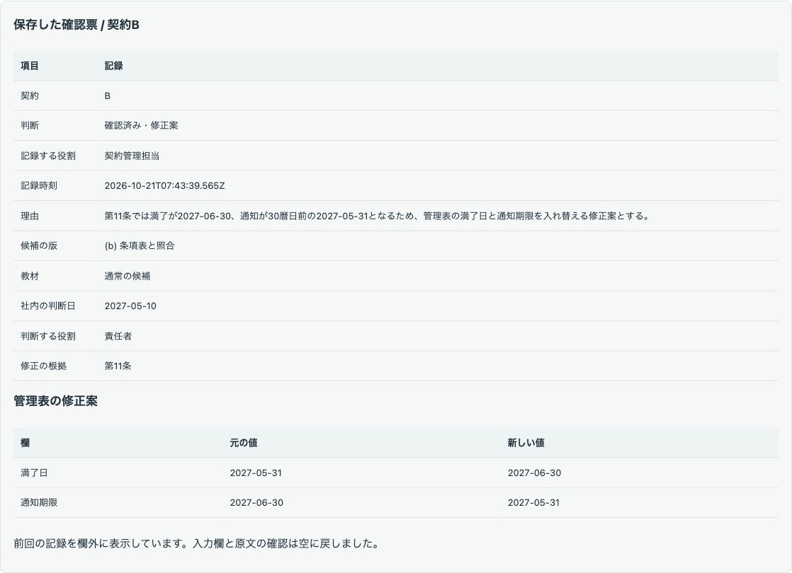
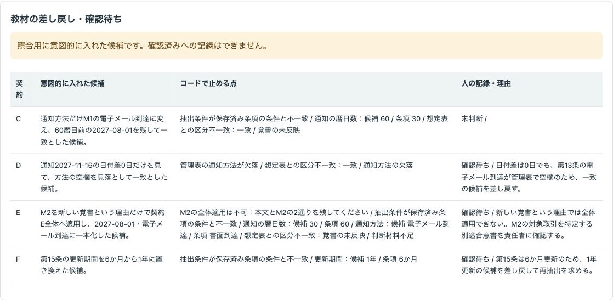
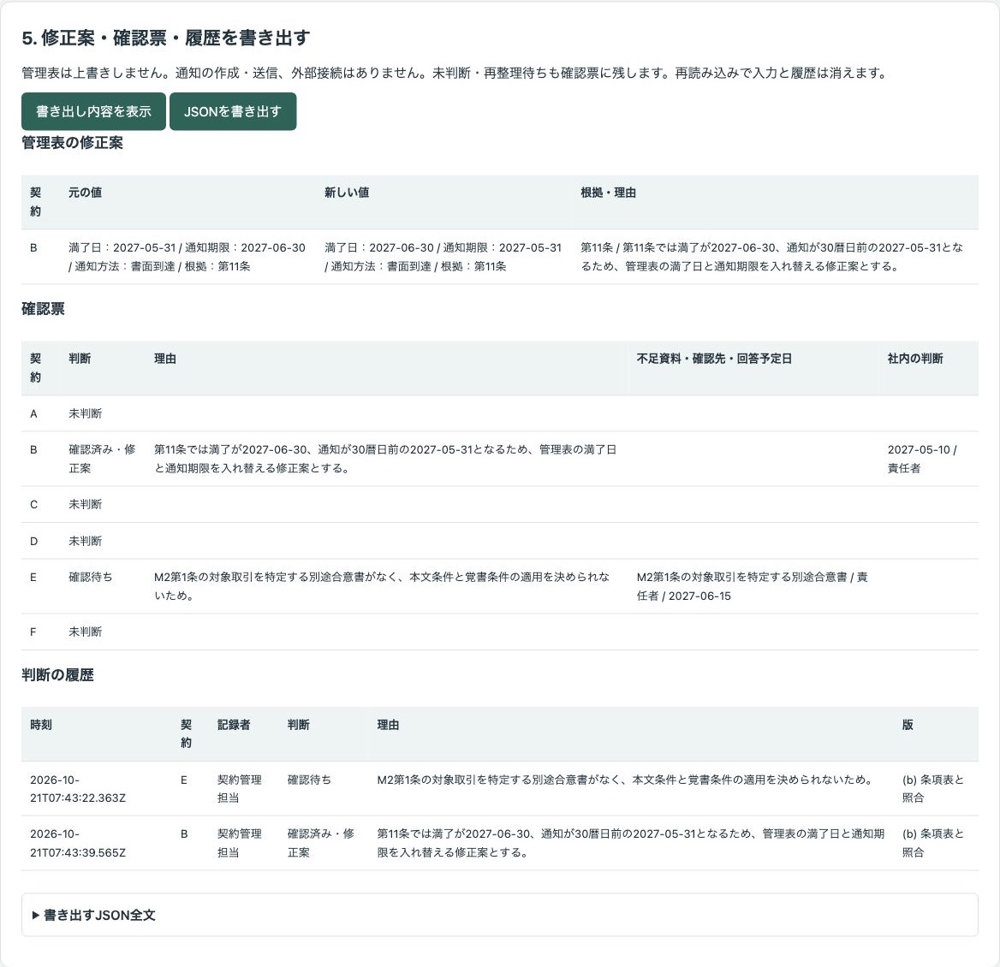

# 架空の契約と覚書から満了日・通知条件の候補を根拠付きで出し、人が原文を確かめて修正案を決めるデモ

契約本文と覚書に戻り、管理表の満了日・通知条件との食い違いを確かめる公開デモです。AIの抽出候補、コードによる暦日の算術、人の判断を並べ、管理表の修正案・確認票・判断の履歴をJSONで書き出せます。

会社・契約・担当の役割・データはすべて架空で、実績ではありません。架空ラボ商会と架空取引先A〜Fの契約6件・覚書2件を使います。実データ・個人情報・認証情報は入力しないでください。

## 画面の画像

### 管理表だけの整理と、条項表を使った照合

管理表だけではCが「異常なし」になります。条項表と照合すると、第12条に優先するM1第1条の通知条件が見つかります。





### 覚書の適用を決められない契約

Eは本文条件とM2適用時の両方を残し、どちらも選びません。





### 人の修正案



### 意図的に入れた誤りを止める



### 書き出し



## 試せること

1. 条項表8行・管理表6行・想定表6行を開きます。各表のCSVを編集・貼り付けし、「CSVを反映」を押します。「行を追加」でも追加できます。項目名は先頭行に表示しています。契約IDで各表を対応させ、新しい契約には条項表と想定表も追加してください。
2. 候補の版を切り替え、契約ごとに管理表・AIの候補と根拠・コードの計算と差を比べます。差は「候補 − 管理表」で示します。方法・根拠の欠落や日付の順序も確認します。
3. 原文を開き、覚書のある契約は覚書も開きます。判断・記録する役割・理由を入力します。「一致として採用」と「修正案を作る」には、通知期限より前の社内の判断日と判断する役割も必要です。
4. Eは別途合意書がないため「確認待ち」にします。不足資料・確認する役割・社内の回答予定日・理由が必須です。Bは修正する欄を選び、満了日を2027-06-30、通知期限を2027-05-31にする修正案と、第11条の根拠を記録できます。
5. 「書き出し内容を表示」で修正案・確認票・履歴を確かめ、「JSONを書き出す」で保存します。未判断の契約や再整理待ちの契約も確認票に含みます。

人が書く欄は空から始まります。記録後や契約を開き直した後も、理由・チェック・原文を開いた記録は引き継ぎません。保存した判断は欄外に表示します。版の切り替えや候補の取り込みは既存の判断を解除します。入力を編集したときは該当契約の判断を解除し、「コード（入力・候補の変更）」として履歴に残します。再読み込みすると入力・判断・履歴はすべて初期状態に戻ります。

## 実際の業務で使うイメージ

想定する使い方は、契約管理担当が原文と管理表を照合し、適用範囲が分からない覚書を責任者や専門家へ確認し、確認後の修正案を社内で判断する流れです。実際に導入した実績を示すものではありません。

## AI・コード・人の分担

| 担当 | 行うこと |
| --- | --- |
| AI | 満了日・更新条件・通知の暦日数と方法、覚書の変更範囲・優先の根拠、食い違いの区分と理由の候補を整理する。適用関係・期限・採否は決めない。条項の文はデータとして扱う。 |
| コード | 抽出値から暦日数を引く。管理表との差、欠落・順序、想定表との区分を比較する。保存済みの架空条項では抽出条件も比較する。原文確認と必須項目を制御し、書き出す。 |
| 人 | 原文と覚書を確認し、必要な資料を求める。責任者や専門家への確認、修正案の採否・理由、社内の判断日と役割を決める。通知・手続きはデモの外で行う。 |

### 実演モードと候補の取り込み

外部APIは使いません。キーなしで動き、事前に用意したAIの出力例をJSONから再生します。その場でAIを呼んでいません。入力を変えた契約は再整理待ちとなり、保存済みの候補を使わず、AIも再処理しません。

取り込んだ候補は、取り込み時点の入力にだけ対応します。入力変更後に新しい候補を取り込んでも、(a)・(b)・教材の版では変更した契約は再整理待ちのままです。さらに入力を変えると、取り込んだ候補も使えなくなり、再取り込みが必要です。

画面の「抽出・区分の指示をコピー」には、その時点の架空の入力・出力項目の説明・指示が含まれます。デモから外部へ送信はしません。任意の生成AIで用意した候補、または人が編集した候補を「候補JSON」に貼り付けられます。形式は `{"candidates":[…]}` です。画面の指示にも形式を表示しています。

各候補は `contract`（契約ID）、`category`（区分）、`reason`（具体的な理由）、`ambiguous`（適用未確定）、`options`（抽出条件1〜2通り）を持ちます。抽出条件には `end`（YYYY-MM-DD）、`days`（0〜3660の整数）、`method`（到達方法）、`renewal`（更新期間）、`refs`（条項IDの配列）が必要です。M2がある契約は `ambiguous: true` と本文・覚書の順の2通りを必須とします。取り込み後も原文を開いて人が判断します。新しい契約の自由な原文をコードが解釈することはありません。

入力表は各1〜100行を扱います。CSVの先頭行・列順を保ち、契約IDは英大文字1〜8文字にしてください。CSVに未反映の編集がある間は判断・書き出しを止めます。

### 比較用の版と教材

(a) は管理表だけの整理、(b) は条項表との照合です。想定表は同じAIが作ったもので、担当者の正解表ではありません。

教材には、EでM2を根拠なく全体へ適用する、Cで通知方法だけ変更して旧期限を残す、Fの更新期間を1年にする、Dで日付差0日だけを見て一致とする候補を入れています。**この版は照合用に意図的に入れた候補です。AIの自然な失敗を観察した結果ではありません。** (a) と教材の版は確認待ち・差し戻しの記録だけができ、確認済みには進めません。教材の書き出しには `version` と `teaching: true` を含み、履歴にも当時の版を残します。

## 起動手順

Node.js 22以上を使います。追加のパッケージは不要です。

```sh
git clone https://github.com/gishi-dev/contract-renewal-clause-review.git
cd contract-renewal-clause-review
npm start
```

ブラウザで `http://127.0.0.1:4198` を開きます。停止はターミナルで `Ctrl+C` です。ポートを変える場合は `PORT` 環境変数を指定してください。構文の確認は `npm run check` です。`.env` は読み込みません。

## デモの範囲と実業務で必要なこと

日付は架空条項の暦日数を引いた算術上の候補で、法的な期間計算ではありません。月末・休日・発送と到達の違いは扱いません。一致は想定表との一致で、期限の確定ではありません。法的な判断は責任者と専門家が行います。契約の有効性や解約の可否を確定する機能はありません。時間削減・精度・費用など、測っていない効果は示しません。

実際の契約ファイルの読み込み、管理表の自動更新、通知文の作成・送信、外部接続、AIによる自由な操作・コード実行はありません。入力と履歴はブラウザのメモリ内だけに置きます。実業務では原本と適用資料の管理、専門家による期間計算と法的確認、承認権限、永続化と監査、個人情報・機密情報の保護を別途設計する必要があります。

## 使っているOSSとライセンス

このデモはMITライセンスです。著作権者は `gishi-dev` です。Node.jsの標準モジュールとブラウザの標準機能を使い、追加のOSSパッケージは使っていません。Node.js自体のライセンスはMITを中心とし、同梱コンポーネントにはそれぞれのライセンスが適用されます。
